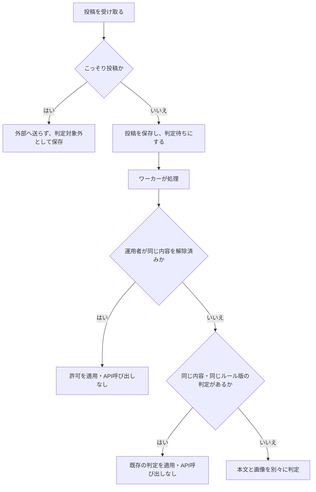
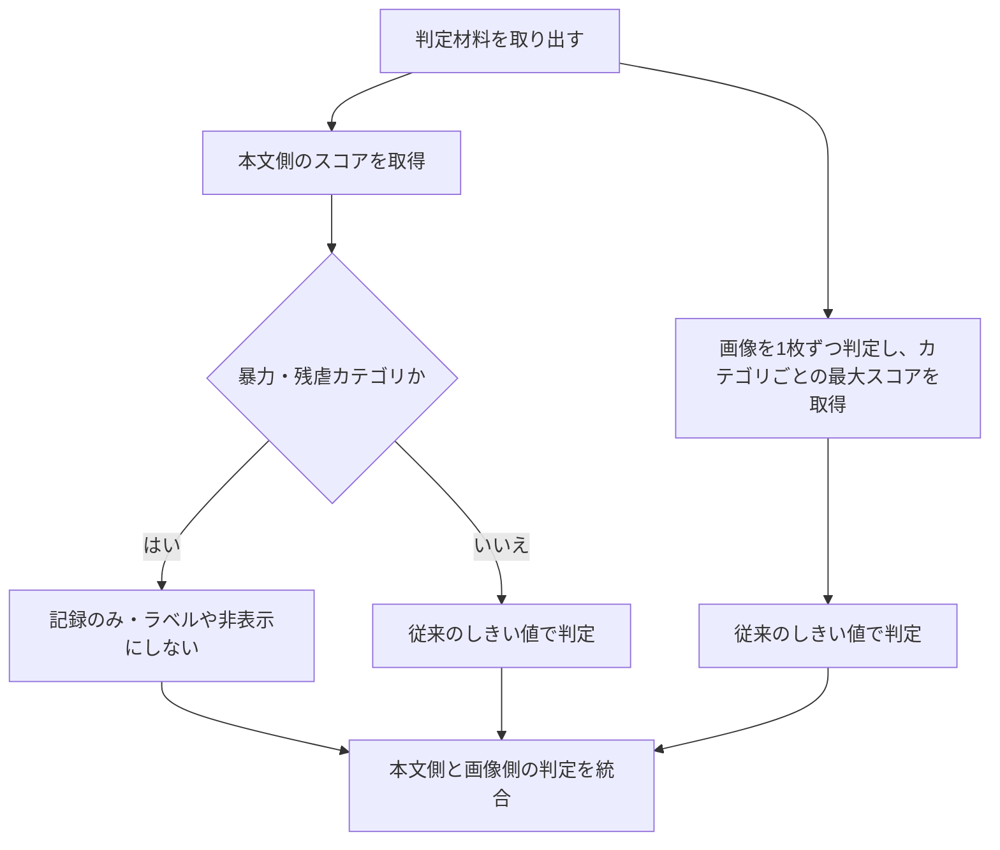
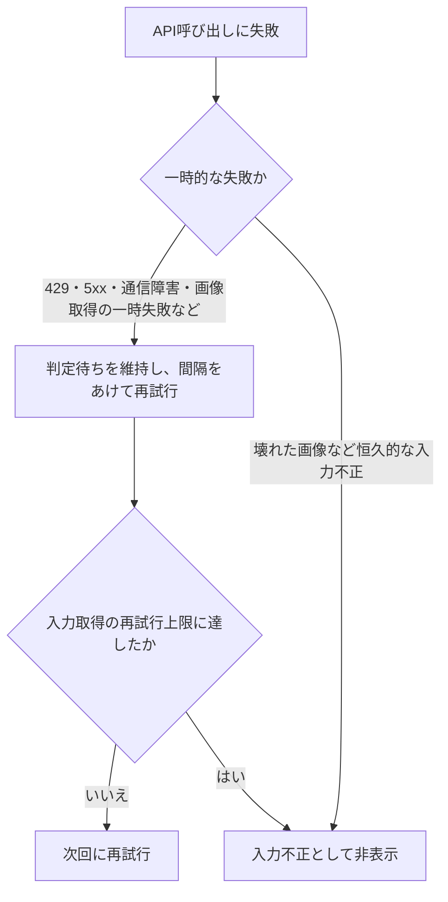

# Nagi の投稿がモデレーションされるまで

2026-10-13 更新。ルールバージョン: `nagi-moderation-v4`。

投稿を保存した後、バックグラウンドで本文と画像を別々に判定する。
**本文の暴力・残虐描写だけでは制限しない。画像の暴力・残虐描写は制限対象になる。**

## 1. 投稿を受け取り、判定待ちにする

投稿の取り込み処理は、OpenAI の応答を待たずに保存を完了する。
判定対象の投稿は「判定待ち」にし、ワーカーが後から処理する。
こっそり投稿は対象外で、本文も画像も OpenAI へ送らない。
API キーが未設定なら自動判定機能は無効になる。

「同じ内容」は CID で識別する。編集で内容が変われば、解除や古い判定をそのまま適用せず判定し直す。
取得失敗の再試行上限に達した場合は、通常の判定キャッシュ再利用よりも入力不正の確定を優先する。

## 2. 本文と画像を分けて OpenAI へ送る

投稿から次の材料を取り出す。

| 判定する側 | 材料 | 送信方法 |
|---|---|---|
| 本文側 | 本文、画像・動画の alt、リンクカードのタイトル・説明 | 空でなければまとめて1回 |
| 画像側 | 添付画像、動画のサムネイル | 本文を添えず、1枚につき1回 |

動画本体は判定しない。画像が複数あれば、カテゴリごとに最も高い画像スコアを採用する。
実際の API 呼び出しは本文、画像1枚目、画像2枚目…の順で行う。

この図の分岐は判定材料の分離を示しており、API を並列に呼ぶ意味ではない。

本文側で制限しないのは `violence` と `violence/graphic`。
アニメ・映画・ゲームの戦闘や死亡描写への感想、作中の台詞、創作、事件の説明などを通すため、
この2カテゴリは高スコアでも制限しない。観測しきい値以上なら理由に記録する。

その他の本文カテゴリ（脅迫、性的内容、自傷等）と画像側は、従来のしきい値で判定する。
スコアが非表示しきい値以上なら非表示、ラベルしきい値以上ならラベル付与、それ未満なら許可。
しきい値の正本は [rules.ts](../apps/nagi_appview/src/services/moderation/rules.ts) の `DEFAULT_THRESHOLDS`。

## 3. 判定を統合して、表示へ反映する

本文側と画像側で結果が違えば、**非表示 → ラベル付与 → 許可**の順で強い方を採用する。
ラベルは両方の結果をまとめる。

| 本文側の結果 | 画像側の結果 | 投稿全体の結果 |
|---|---|---|
| 暴力スコアが高いだけ → 許可 | 画像なし | 許可 |
| 暴力スコアが高いだけ → 許可 | 許可 | 許可 |
| 暴力スコアが高いだけ → 許可 | 性的内容でラベル付与 | ラベル付与 |
| 許可 | 残虐画像として非表示 | 非表示 |
| 別カテゴリで非表示 | 許可 | 非表示 |

- **許可**: AppView の投稿に自動ラベルなしの判定結果を反映する。
- **ラベル付与**: 投稿にラベルを付ける。閲覧者の設定・年齢に応じて警告や表示制限がかかる。
- **非表示**: AppView の表示対象から外す。PDS の原投稿を削除する処理ではない。

判定結果・ラベル・最高スコア・カテゴリ・ルール版を DB に記録する。
判定理由には `[TEXT]` / `[IMAGE]` を付け、本文と画像のどちらが根拠か区別する。

## 4. API で判定できなかった場合

入力不正の `reject-invalid` と、内容による非表示の `reject-policy` は別の結果として扱う。

## 呼び出し回数と既存投稿への影響

キャッシュや運用者の解除を使わず、新しく判定する場合の回数は次のとおり。

| 判定材料 | OpenAI Moderation API の回数 |
|---|---:|
| 本文も画像もなし | 0回 |
| 本文のみ | 1回 |
| 画像のみ N枚 | N回 |
| 本文 + 画像 N枚 | N + 1回 |

本文 + 画像1枚なら2回、本文 + 画像4枚なら5回。旧実装より、本文付き画像投稿で1回増える。
Ollama や二次確認用の生成モデルは呼ばない。失敗時の再試行は別途発生する。

ルール更新だけでは、既存投稿のラベルや非表示を自動解除しない。
必要な投稿は運用者の解除操作等で復元する。全件の一斉再判定は行わない。

## 運用上の線引きと、まだ実装していないこと

運用方針は、乳首・性器の露出、明示的な性行為、残虐・具体的な脅迫を含む画像を通さないこと。
現在はカテゴリスコアで判定しており、乳首と下着などを直接見分けて確認する処理はない。
今回、画像のしきい値は変更していない。

文章の具体的な加害予告と作品の台詞を文脈で区別する二次確認も未実装。
本文の暴力・残虐カテゴリによる制限は解除したが、別カテゴリによる誤判定は残り得る。

実装: [moderation/](../apps/nagi_appview/src/services/moderation/)、
[moderationWorker.ts](../apps/nagi_appview/src/ingest/moderationWorker.ts)。
